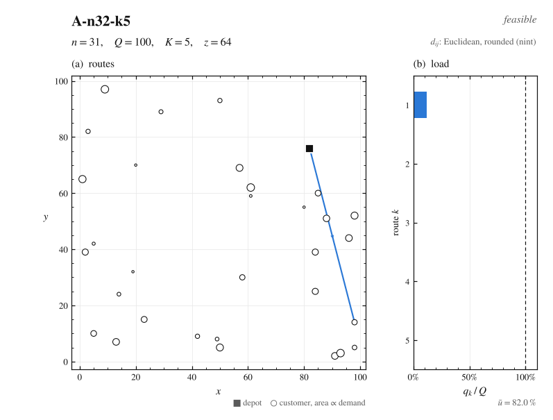
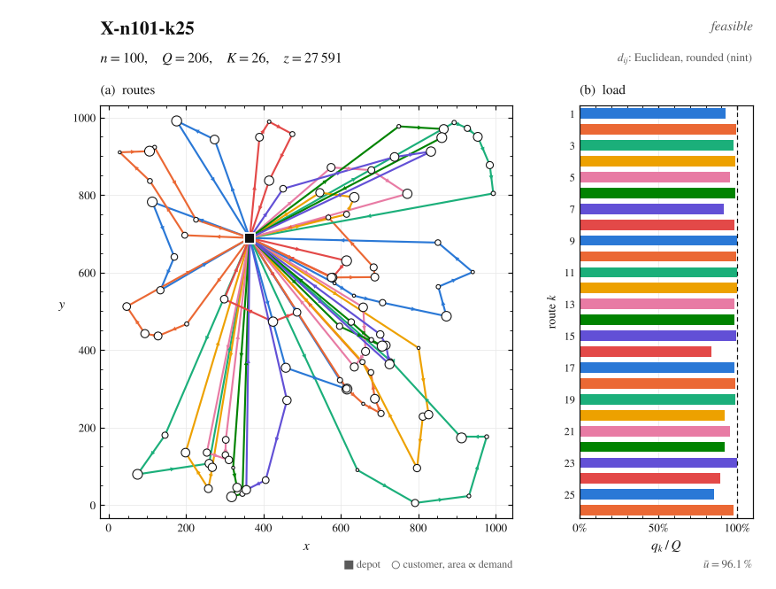

# routeviz

Plot, animate and **verify** vehicle routing (CVRP) solutions from the command line.

<p align="center">
  
</p>

Reads the standard [CVRPLIB](http://vrp.galgos.inf.puc-rio.br/index.php/en/) formats
(`.vrp` instance, `.sol` solution), so it works out of the box with benchmark
instances and with the output of most solvers.

## Install

```bash
uvx --from git+https://github.com/jonasgrau/routeviz routeviz --help
# or
pip install git+https://github.com/jonasgrau/routeviz
```

## Usage

```bash
routeviz check   A-n32-k5.vrp A-n32-k5.sol            # feasibility + recomputed cost
routeviz plot    A-n32-k5.vrp A-n32-k5.sol -o out.svg # also .png / .pdf
routeviz animate A-n32-k5.vrp A-n32-k5.sol -o out.gif # routes drawn edge by edge
```

Figures are laid out like a journal figure: **(a)** the routes on the instance's
coordinate plane, with travel direction, the depot (■) and customers whose circle
area is proportional to demand; **(b)** each route's load $q_k/Q$ against the
capacity line, with the mean utilisation $\bar u$. The header gives $n$, $Q$, the number
of routes $K$, the objective $z$, the distance convention and the feasibility verdict.
In the animation, $z$ and the load bars grow as the tours are drawn.

Options: `--labels` (customer ids), `--dark`, `--size`, `--no-load-panel`; for
`animate` also `--fps` and `--max-frames`.

### `check`: don't trust a reported cost

```text
$ routeviz check A-n32-k5.vrp A-n32-k5.sol
A-n32-k5: 31 customers, 5 routes, capacity 100, rounding nint
  route   1:    7 customers  load 98/100  cost 155
  route   2:    4 customers  load 72/100  cost 73
  ...
computed cost: 784
stated cost:   784 (matches)
OK
```

It verifies that

- every customer is visited exactly once (reports missing, duplicate and unknown ids),
- no route exceeds the vehicle capacity,
- no route exceeds the length limit `DISTANCE` (including `SERVICE_TIME`), if the instance has one,
- the number of vehicles stays within `--max-vehicles`, if given,
- the cost stated in the `.sol` file matches the recomputed cost.

Exit code `0` = OK, `1` = infeasible or cost mismatch, `2` = unreadable input,
so it can gate a benchmark script or CI. `--json` prints a machine-readable report.

**Distance convention.** Edge lengths follow `EDGE_WEIGHT_TYPE` (TSPLIB): `EUC_2D`
is rounded to the nearest integer, `CEIL_2D` rounded up. Several classic sets
(Christofides–Mingozzi–Toth, Golden, Li, Taillard) declare `EUC_2D` but are scored
with unrounded distances. If the header convention does not reproduce the stated
cost but unrounded distances do, routeviz switches to unrounded and says so.
Force a convention with `--rounding nint|ceil|none`.

Tested against the published solutions of A-n32-k5, B-n31-k5, P-n16-k8, F-n72-k4,
M-n101-k10, X-n101-k25, CMT6, Golden_1, Li_21 and tai75a: all costs reproduce exactly.

## Large instances

With more than eight routes there is no legend; colours are assigned in angular
order around the depot (by route centroid), so routes that are next to each other
in that order never share a colour. Heavily overlapping routes can still coincide.

<p align="center">
  
</p>

## Limitations

- Instances need node coordinates; explicit distance matrices (`EXPLICIT`) are rejected.
- Single depot only. No time windows (Solomon format) yet.

## Development

```bash
pip install -e ".[dev]"
pytest
```

Example instances: see [`examples/`](examples/). MIT licensed.
